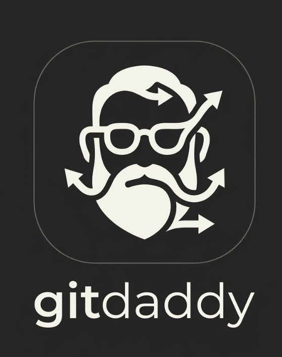
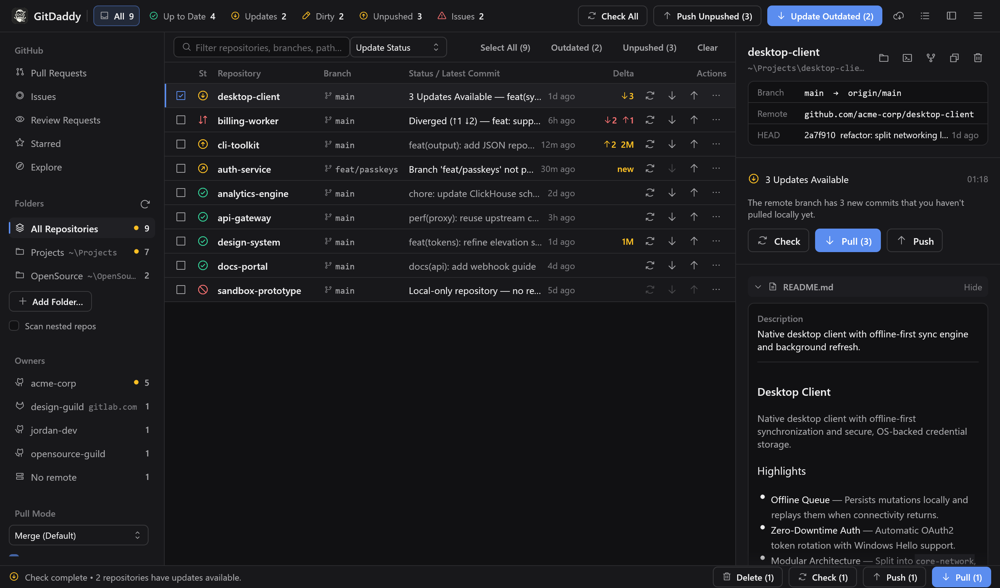
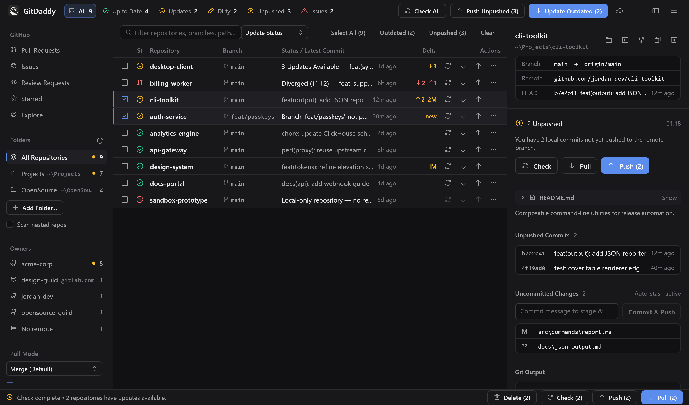
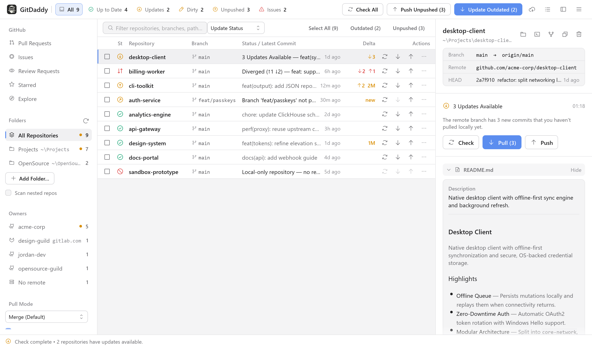
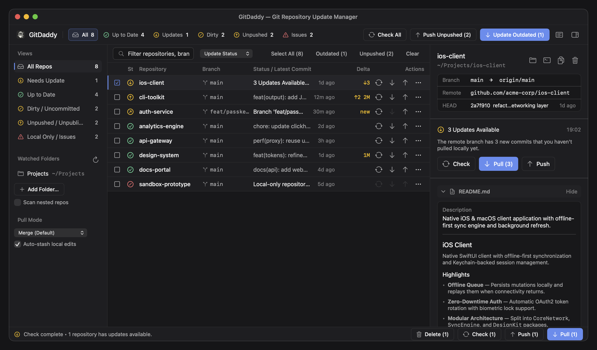
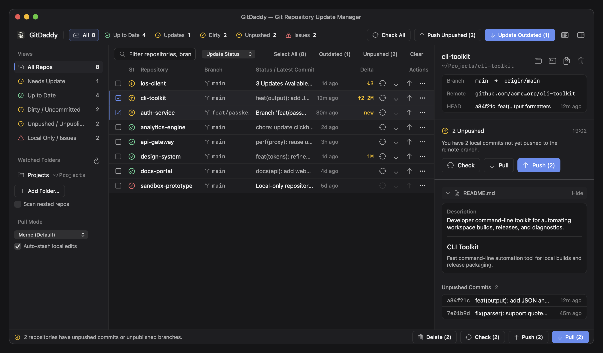
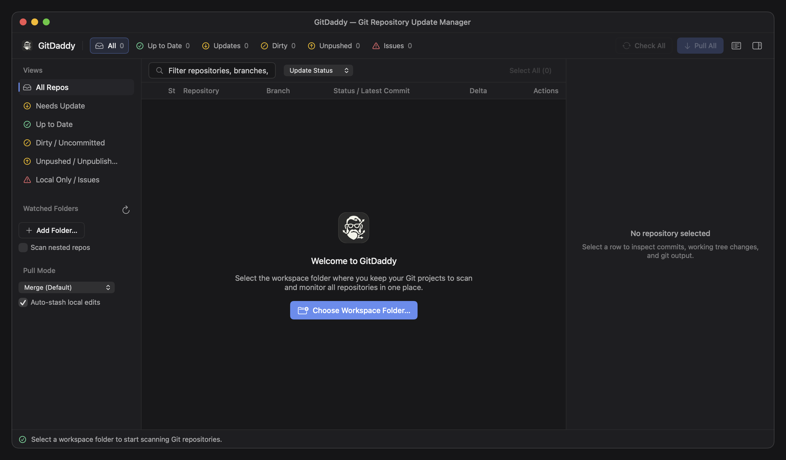
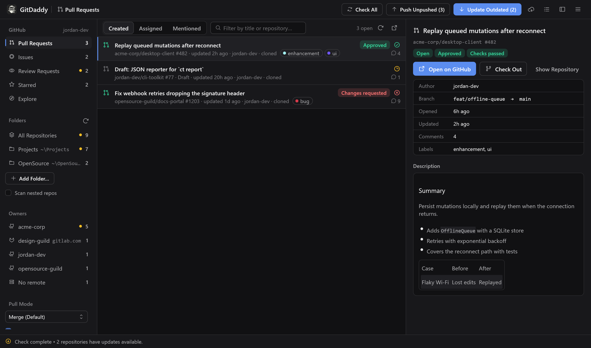
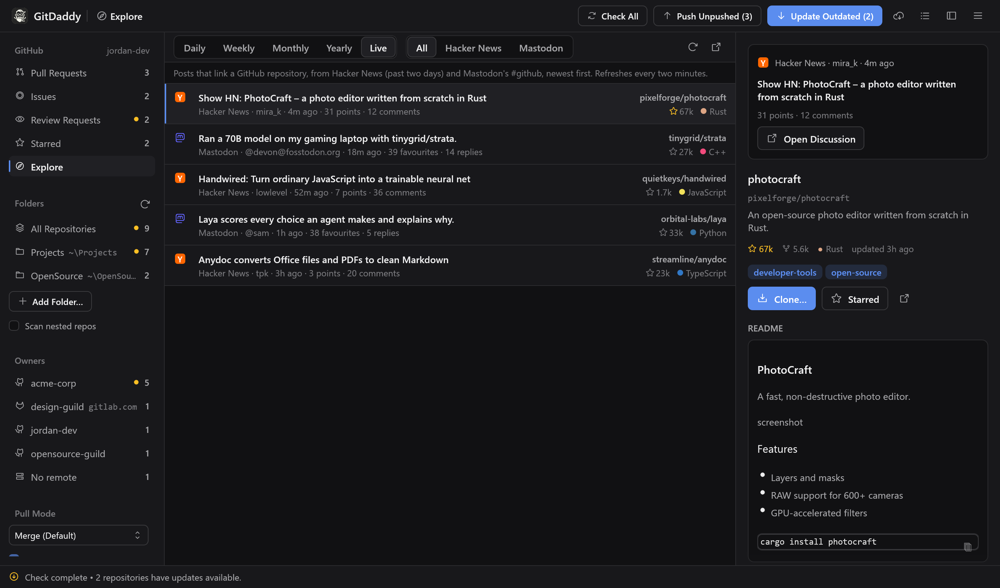
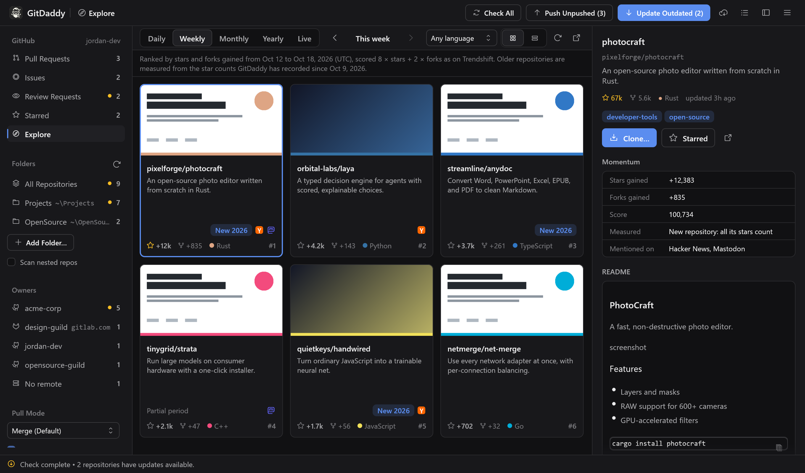

<p align="center">
  
</p>

<h1 align="center">GitDaddy</h1>

<p align="center">
  <strong>Your repos need a responsible adult.</strong><br />
  Native on macOS and Windows.
</p>

<p align="center">
  <a href="https://github.com/Duyfrom/GitDaddy/releases/latest">Download</a> ·
  <a href="#windows">Windows</a> ·
  <a href="#macos">macOS</a> ·
  <a href="#using-gitdaddy">Usage</a> ·
  <a href="#build-from-source">Build from source</a>
</p>

We both know how this goes. You clone a repo to "just take a quick look", then another, then forty more. A few months later your projects folder is a graveyard: repos you forgot you ever cloned, forks of other people's projects, half of them several hundred commits behind, and at least one with uncommitted changes you're too scared to open.

GitDaddy is the responsible adult your workspace never had. Point it at your folders and it finds every Git repo inside, yours or anyone else's. It tells you which ones are behind, ahead, dirty, or orphaned, then pulls, pushes, and cleans them up in batches, so nothing rots in a corner again. It runs natively on **macOS** and **Windows**.

<p align="center">
  
</p>

---

## What it does

You pick one or more parent folders. GitDaddy finds every Git repository inside them, runs `git fetch` on each one, and shows a single table of which repositories are behind their remote, which have unpushed commits or uncommitted files, and which have no remote at all. From that table you can pull, push, publish a branch, commit, or delete a local clone, one repository at a time or as a batch.

GitDaddy is a front end for the `git` command you already have installed. It runs the same commands you would type and shows their output. It never stores credentials, so a repository that needs a password prompt will fail to sync until you set up an SSH key or a credential manager (see [Authentication](#authentication)).

There are two native apps in this repository, with the same features:

| | Windows | macOS |
| :--- | :--- | :--- |
| Language | Rust ([egui](https://github.com/emilk/egui)) | Swift (SwiftUI) |
| Source | [`windows/`](windows) | [`Sources/GitDaddy/`](Sources/GitDaddy) |
| Requires | Windows 10 or 11 (x64), [Git for Windows](https://git-scm.com/download/win), and the [GitHub CLI](https://cli.github.com) for forking and the GitHub views | macOS 14 Sonoma or later, Git, and the [GitHub CLI](https://cli.github.com) for forking and the GitHub views |
| Download | `GitDaddy-<version>-windows-x64-setup.exe` or `-portable.zip` | `GitDaddy-macOS.zip` |

---

## Windows

<p align="center">
  
</p>

### Install

1. Download `GitDaddy-<version>-windows-x64-setup.exe` from the [latest release](https://github.com/Duyfrom/GitDaddy/releases/latest).
2. Run it. The installer does not need administrator rights. By default it installs for your account only, into `%LOCALAPPDATA%\Programs\GitDaddy`, and adds a Start menu entry. It also offers an all-users install.
3. Start GitDaddy from the Start menu.

The installer and the app are not code-signed yet, so Windows SmartScreen may show "Windows protected your PC" the first time. Click **More info**, then **Run anyway**. Each release lists SHA-256 checksums in `GitDaddy-<version>-windows-x64-SHA256SUMS.txt` if you want to verify the download.

**Portable version.** If you'd rather not install anything, download `GitDaddy-<version>-windows-x64-portable.zip`, extract it anywhere, and run `GitDaddy.exe`. Settings are stored in the same place for both versions.

**Uninstall.** Use **Settings → Apps → Installed apps → GitDaddy → Uninstall**. Your settings stay in `%APPDATA%\GitDaddy` until you delete that folder.

### Updates

Click the cloud icon in the top bar, or **☰ → Check for Updates…**, to look for a newer Windows release on GitHub. GitDaddy also checks by itself once a day at startup; turn that off with **Check automatically** in the update dialog. An automatic check never interrupts you. When it finds a release, a **New version x.y.z** button appears in the top bar.

**Download & Install** fetches the setup from the release and checks it against the release's `SHA256SUMS` file. It refuses to install a file that doesn't match, or a release that has no checksum file. The installer then runs with a progress window, replaces GitDaddy in its current folder with the same per-user or all-users scope, and reopens it. On this machine the whole update took about 3 seconds. Install is disabled while Git operations are running, so a pull or push is never cut off.

The portable version can't update itself. Its update dialog links to the release page instead.

### Windows specifics

- GitDaddy looks for `git.exe` on your `PATH`, then in the default Git for Windows, per-user, and Scoop install folders. If none is found, the sidebar shows a download link.
- **Open in Terminal** uses Windows Terminal when it's installed and falls back to PowerShell.
- Deleting a repository moves it to the **Recycle Bin**, or deletes it permanently if you choose that. Git's read-only object files are handled.
- The app follows the Windows light or dark setting. To override it, open the **☰** menu → **Appearance**.

<p align="center">
  
</p>

---

## macOS

<p align="center">
  
</p>

### Install

**Option 1: download.** Get `GitDaddy-macOS.zip` from the [Releases](https://github.com/Duyfrom/GitDaddy/releases) page, unzip it, and drag `GitDaddy.app` into `/Applications`. The app is ad-hoc signed, so if Gatekeeper blocks the first launch, run:

```bash
xattr -cr /Applications/GitDaddy.app
open /Applications/GitDaddy.app
```

**Option 2: build and install with one command.** This needs Xcode or the Xcode Command Line Tools (`xcode-select --install`). `install.sh` compiles a release build, bundles the icon, copies `GitDaddy.app` into `/Applications` (or `~/Applications` if that isn't writable), and opens it:

```bash
git clone https://github.com/Duyfrom/GitDaddy.git
cd GitDaddy
./install.sh
```

**Option 3: build inside the repo folder** without installing:

```bash
./build_app.sh
open GitDaddy.app
```

<p align="center">
  
</p>

---

## Using GitDaddy

The two apps work the same way. Where they differ, both names are given (macOS / Windows).

### 1. Choose your workspace folders

On first launch, click **Choose Workspace Folder…** and select the folder where you keep your projects. You can add more later with **Add Folder…** in the sidebar, and remove one by hovering over it and clicking **×**.

GitDaddy searches five folder levels deep. It skips hidden folders, symlinks, and dependency or build folders such as `node_modules`, `target`, `dist`, `build`, `.venv`, and `vendor`. It stops descending once it finds a repository, unless you turn on **Scan nested repos**. Folders you add are remembered between launches.

<p align="center">
  
</p>

### 2. Pick folders and owners

The sidebar decides which repositories you're looking at. The header tabs then filter that set by status.

- **All Repositories** shows everything GitDaddy found.
- Click a **watched folder** to see only the repositories inside it.
- Click an **owner** to see only that account's or organization's repositories. The owner comes from the remote URL, so `git@github.com:Duyfrom/GitDaddy.git` belongs to `Duyfrom`. Hosts other than GitHub are named next to the owner.
- **No remote** lists local-only repositories.

A yellow dot next to an entry means something in it has updates to pull. Click the selected entry again to go back to all repositories.

The header counts, **Check All**, **Update Outdated**, **Push Unpushed**, and the **Outdated** and **Unpushed** selection buttons only cover the repositories in the current folder or owner. Select an owner and click **Update Outdated** to pull just that organization's repositories.

### 3. Check for remote updates

**Check All** runs `git fetch --all --prune` on every repository in view, six at a time, and then compares each branch with its upstream. GitDaddy also checks every repository once at startup, whatever is selected. To check a single repository, click its **↻** button.

Each fetch gets 30 seconds. A repository that can't reach its remote in that time is marked **Sync Error**, and the inspector shows the git output.

### 4. Pull

- **One repository:** click **↓** on its row, or **Pull** in the inspector.
- **Selected repositories:** tick their checkboxes, then click **Pull (N)** in the bottom bar.
- **Everything that's behind:** click **Update Outdated (N)** in the top bar. When nothing is behind, the button reads **Pull All**.

**Pull Mode** in the sidebar sets the strategy for every pull:

| Mode | Command |
| :--- | :--- |
| Merge (Default) | `git pull` |
| Rebase | `git pull --rebase` |
| Fast-Forward | `git pull --ff-only` |

With **Auto-stash local edits** on (the default), GitDaddy adds `--autostash`, so uncommitted changes are stashed before the pull and restored after it.

### 5. Push, publish, and commit

- A row showing **↑N** has commits to push. Click **↑**, or **Push Unpushed (N)** in the top bar to push every such repository.
- A row showing **new** is on a branch that doesn't exist on the remote yet. **Publish** runs `git push -u <remote> <branch>`.
- A row showing **NM** has N uncommitted files. Select it, type a message under **Uncommitted Changes** in the inspector, and click **Commit & Push**. This runs `git add -A`, so every change and untracked file in the repository is included. A repository without a remote is committed but not pushed.

### 6. Fork a repository

Choose **Fork…** from a repository's **⋯** or right-click menu, or click **Fork…** in the inspector. The dialog has two tabs.

**On GitHub** is for a project you cloned from someone else and now want to push changes to. GitDaddy creates your own copy on GitHub and rewires this clone. The dialog shows the result before you click **Fork**:

- `origin` → your new fork. Pushes go here.
- `upstream` → the original. Pulls keep bringing in its updates, so the repository still shows **Updates Available** when the original moves on.

GitHub forking uses the [GitHub CLI](https://cli.github.com). If it isn't installed, the dialog links to the download. If it isn't signed in, **Sign in with GitHub…** opens a terminal for the one-time browser sign-in. If you belong to GitHub organizations, you can fork into one of them instead of your own account. Forked repositories show a **Fork of** line in the inspector, their **↑** count is the number of commits not yet in your fork, and GitDaddy sets `remote.pushDefault` so a plain `git push` in a terminal also goes to the fork.

**On this Mac / On this PC** makes an independent copy in a new folder, for experiments you want to keep away from your main clone. It works for any repository, including local-only ones and ones not hosted on GitHub. The folder defaults to `<name>-fork` next to the original; change it or click **Browse…**. The copy gets every branch, tag, remote, and upstream setting, so it shows the same status as the original straight away, and it keeps no link back to the original folder. Uncommitted changes stay in the original, so commit first if you want them in the copy. When it's done, the copy is added to the list and selected. If it's outside your watched folders, its folder is added to them.

### 7. GitHub: pull requests, issues, reviews, stars, and Explore

<p align="center">
  
</p>

The **GitHub** section in the sidebar swaps the repository list for a view of your GitHub account. It uses the GitHub CLI sign-in, the same one forking uses. If the CLI isn't installed or signed in, the view offers to fix that.

| View | What it shows |
| :--- | :--- |
| **Pull Requests** | Your open pull requests: ones you created, are assigned to, or are mentioned in. Each row shows CI status, the review decision, labels, and comments. |
| **Issues** | Your open issues, with the same three filters. |
| **Review Requests** | Open pull requests waiting for your review. A yellow dot in the sidebar means someone is waiting. |
| **Starred** | Your 100 most recently starred repositories. |
| **Explore** | Trending repositories, by day, week, month, or year, and a live feed of posts about repositories. |

Select a row to see it in the inspector. Pull requests and issues show their description, branch, and status. For a pull request whose repository you have cloned, **Check Out** runs `gh pr checkout` in that clone. Repositories show their README. **Clone…** clones one into a watched folder, and **Star** stars or unstars it. Double-click any row to open it on github.com.

**Explore** works like [Trendshift](https://trendshift.io). *Daily*, *Weekly*, *Monthly*, and *Yearly* rank repositories by what they gained in that calendar period (UTC), with Trendshift's score: 8 × stars gained + 2 × forks gained. Use **‹** and **›** to step back to earlier periods, back to GitHub's launch in 2008, and the language menu to narrow the list. Each repository shows its gains, a **New** tag if it was created this year, and the platforms that mentioned it. The inspector's **Momentum** box says how each gain was measured.

GitHub no longer shows who starred a repository or when, so no API can answer "stars gained this week". Explore measures gains two ways:

- **New repositories** gained every star they have, so they rank from day one.
- **Older repositories** are measured from star counts GitDaddy records. It saves the counts of repositories it sees, your clones, and your stars, plus a daily batch of active popular repositories. It records them every hour while it runs and keeps them in `%LOCALAPPDATA%\GitDaddy\star-history.json`. A gain is complete once GitDaddy has a count from before the period began. Before that, it covers only the time since the first count and is marked partial.

**Live** lists recent posts that link a GitHub repository: Hacker News stories from the past two days and Mastodon's #github posts, newest first, refreshed every two minutes. Filter by platform, and select a post to see it next to the repository's README. Both sources are free and need no account.

<p align="center">
  
</p>

**Starred** and **Explore** show repositories as a compact list or as cards. Each card shows the repository's GitHub preview image, the picture you see when its link is shared. Switch with the grid and list buttons in the toolbar, and GitDaddy remembers your choice. Preview images are cached on disk. GitHub allows about 100 preview images per 15 minutes, so after heavy browsing the rest show a placeholder until the limit resets.

<p align="center">
  
</p>

Lists refresh when you open a view or when you click the refresh button.

### 8. Inspect a repository

Click a row to open it in the inspector on the right:

- Branch and upstream, remote host, fork parent (when applicable), and the HEAD commit.
- The repository description and its README. GitDaddy reads the README and renders the Markdown (including tables, code blocks with copy buttons, and images stored in the repository). Click **Hide** to collapse it.
- Incoming and unpushed commits, with hash, subject, and age.
- Uncommitted files, up to 30.
- **Git Output**: the full output of the last command run on that repository.

The **Activity Log** button in the top bar lists the last 250 operations in this session, with their output.

### 9. Delete a local clone

Click the trash icon in the inspector, choose **Delete Local Repository…** from a row's **⋯** or right-click menu, or select several rows and click **Delete (N)**. You can move the folder to the Trash / Recycle Bin or delete it permanently. GitDaddy warns you first if any selected repository has unpushed commits, an unpublished branch, or uncommitted files. Only the local folder is removed. Nothing changes on GitHub, GitLab, or any other remote.

### Authentication

GitDaddy runs git non-interactively, with `GIT_TERMINAL_PROMPT=0` and Git Credential Manager prompts turned off. With 4 to 6 operations running in parallel, a password prompt would have nowhere to appear. Unless you've set `GIT_SSH_COMMAND` (or, on Windows, `core.sshCommand`), SSH runs in batch mode and accepts new host keys automatically.

So before using GitDaddy, make sure `git fetch` works in a terminal without asking you anything:

- **SSH:** load your key into an agent. On Windows, if you use the OpenSSH agent service, set `git config --global core.sshCommand "C:/Windows/System32/OpenSSH/ssh.exe"` so git uses it. GitDaddy will keep that setting.
- **HTTPS:** sign in once with Git Credential Manager (bundled with Git for Windows). GitDaddy then uses the cached credentials.

---

## Repository statuses

| Status | Color | Meaning |
| :--- | :--- | :--- |
| **Up to Date** | Green | The local branch and its upstream point at the same commit. |
| **Updates Available (`↓N`)** | Yellow | The remote has N commits you haven't pulled. |
| **Unpushed (`↑N`)** | Yellow | You have N local commits that aren't on the remote. |
| **Unpublished Branch (`new`)** | Yellow | A remote is configured, but the current branch only exists locally. |
| **Dirty (`NM`)** | Yellow | N files are modified or untracked. This shows alongside any other status. |
| **Diverged (`↑A ↓B`)** | Red | Both sides have new commits. Pull before you push. |
| **Local Only (No Remote)** | Red | The repository has no remote. You can add one from the inspector. |
| **Empty Repo / Detached HEAD** | Red | There are no commits yet, or HEAD isn't on a branch, so pull and push are disabled. |
| **Sync Error** | Red | Git failed. The inspector shows the exact error. |

The status tabs in the top bar filter the table by these groups, within whatever folder or owner is selected in the sidebar. The search box matches repository names, paths, branches, and remote URLs.

---

## Keyboard shortcuts

| Action | macOS | Windows |
| :--- | :--- | :--- |
| Add folder to scan | `⌘O` | `Ctrl+O` |
| Check all remotes (`git fetch`) | `⌘R` | `Ctrl+R` or `F5` |
| Rescan watched folders | `⇧⌘R` | `Ctrl+Shift+R` |
| Pull selected repositories | `⌘P` | `Ctrl+P` |
| Update all outdated repositories | `⇧⌘P` | `Ctrl+Shift+P` |
| Push selected repositories | `⌘U` | `Ctrl+U` |
| Push all unpushed repositories | `⇧⌘U` | `Ctrl+Shift+U` |
| Select all visible repositories | `⇧⌘A` | `Ctrl+Shift+A` |
| Focus the search box | `⌘F` | `Ctrl+F` |

Double-clicking a row opens the repository in Finder / File Explorer, and the **☰** menu lists every command (including **Appearance: System / Light / Dark** and **Check for Updates…**).

---

## Build from source

### Windows

You need [Rust](https://rustup.rs) 1.95 or later and Git for Windows. With the default MSVC toolchain, install the Visual Studio Build Tools with the "Desktop development with C++" workload, as rustup suggests.

```powershell
git clone https://github.com/Duyfrom/GitDaddy.git
cd GitDaddy\windows
cargo run --release
```

`cargo test` runs the unit tests and an end-to-end test that drives real git repositories in a temporary folder.

To build the installer and the portable zip, install [Inno Setup 6](https://jrsoftware.org/isdl.php) and run:

```powershell
.\packaging\package.ps1
```

The files are written to `windows\dist`.

The README screenshots are rendered headlessly from sample data, so they never show your own repositories:

```powershell
$env:GITDADDY_SCREENSHOT_DIR = "..\Assets"; cargo test readme_screenshots -- --ignored
```

### macOS

See [macOS → Install](#install-1), options 2 and 3. Both scripts call `swift build -c release`.

### Releases

Pushing a tag that starts with `v` (for example `v1.1.0`) runs [`.github/workflows/windows.yml`](.github/workflows/windows.yml). The workflow builds and tests on `windows-latest`, packages the installer and zip, and attaches them to the GitHub release for that tag. The macOS zip is built locally with `./build_app.sh` and uploaded by hand.

The in-app updater depends on that release layout. The tag must be a version number (`v1.2.0`), the release must not be a draft or pre-release, and its assets must include `GitDaddy-<version>-windows-x64-setup.exe` and `GitDaddy-<version>-windows-x64-SHA256SUMS.txt`. Releases without a Windows setup, such as a macOS-only release, are skipped. Bump `version` in `windows/Cargo.toml` before tagging, because the app compares that number with the tag.

---

## Project structure

```text
GitDaddy/
├── Assets/                      # Logo, macOS app icon, and README screenshots
├── Package.swift                # Swift package manifest (macOS 14+)
├── build_app.sh                 # macOS: builds GitDaddy.app
├── install.sh                   # macOS: builds and installs into /Applications
├── Sources/GitDaddy/            # macOS app (SwiftUI)
│   ├── GitDaddyApp.swift        # App entry point and menu shortcuts
│   ├── Models.swift             # Repository, sync state, and filter models
│   ├── RepoScanner.swift        # Finds .git folders
│   ├── GitService.swift         # Runs git non-interactively & local forks
│   ├── GitHubService.swift      # GitHub CLI (gh) GraphQL/REST & fork operations
│   ├── GitHubHubStore.swift     # State for GitHub views, forking, and updater
│   ├── GitHubHubView.swift      # PRs, Issues, Reviews, Starred, Explore, & modals
│   ├── RepoStore.swift          # State and batch operations
│   ├── ContentView.swift        # Main three-pane window
│   ├── InspectorView.swift      # Inspector and README viewer
│   └── Theme.swift              # Colors, type, and status icons
├── windows/                     # Windows app (Rust)
│   ├── Cargo.toml
│   ├── build.rs                 # Embeds the icon, version info, and manifest
│   ├── assets/                  # .ico, window icon, installer bitmaps
│   ├── packaging/
│   │   ├── GitDaddy.iss         # Inno Setup installer script
│   │   └── package.ps1          # Builds the installer, zip, and checksums
│   └── src/
│       ├── main.rs              # Window setup
│       ├── app.rs               # UI: header, sidebar, table, inspector, dialogs
│       ├── store.rs             # State, settings, and the background job queue
│       ├── git.rs               # Runs git and parses its output
│       ├── github.rs            # Forking through the GitHub CLI
│       ├── hub.rs, hub_ui.rs    # GitHub views: queries, state, list, inspector
│       ├── trending.rs          # Explore: star history, Trendshift score, Hacker News and Mastodon mentions
│       ├── scanner.rs           # Finds repositories
│       ├── model.rs             # Repository and sync state types
│       ├── markdown.rs          # README clean-up before rendering; splits out tables
│       ├── images.rs            # Loads README images, downscaled for the GPU
│       ├── platform.rs          # File Explorer, terminal, Recycle Bin
│       ├── update.rs            # Update check, verified download, installer hand-off
│       ├── theme.rs, widgets.rs # Colors, fonts, and custom controls
│       └── util.rs
└── .github/workflows/windows.yml
```

---

## License

Released under the [MIT License](LICENSE).
